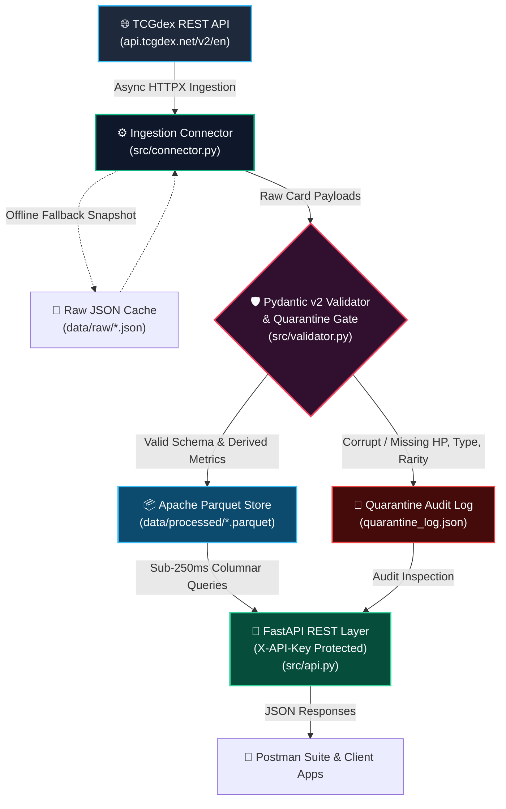

# Pokémon TCG Forward-Deployed Ingestion & Analytics API


A production-grade **Forward-Deployed Data Engineering (FDE)** microservice built with **FastAPI**, **Pydantic v2**, and **Apache Parquet**. The service ingests live Pokémon Trading Card Game (TCG) expansion data from the **TCGdex REST API**, enforces strict domain schema contracts with automated bad-record quarantine, persists normalized datasets to columnar Parquet storage, and serves SLA-monitored analytics endpoints.

---

## System Architecture



---

## Engineering Highlights

* **Resilient Upstream Ingestion (`src/connector.py`):** Asynchronous `httpx` client fetching expansion metadata and granular card payloads with automatic raw JSON snapshotting (`data/raw/{set_id}.json`) to guarantee deterministic offline fallback if upstream APIs rate-limit or degrade.
* **Domain Schema Enforcement & Quarantine (`src/validator.py`):** Pydantic v2 validation pipeline enforcing business rules (e.g., `Pokemon`-category cards must possess positive integer HP, elemental typing, and valid rarity tiers). Malformed records are isolated into an auditable quarantine log rather than crashing batch runs.
* **Derived Analytical Features:** Automatically extracts numeric attack ceilings across multi-attack movesets and computes `damage_per_hp_ratio` combat efficiency metrics during ingestion.
* **Columnar Parquet Persistence (`src/api.py`):** Stores validated expansion datasets in compressed Apache Parquet (`pyarrow`), enabling sub-250ms filtered queries and analytical aggregations without external database overhead.
* **API Security & Automated Verification:** Protected via `X-API-Key` header dependency injection, validated by a `pytest` unit/integration suite (`tests/test_api.py`), Ruff static linting, GitHub Actions CI (`.github/workflows/ci.yaml`), and a portable Postman v2.1 collection (`postman/`).

---

## Repository Structure

| Path | Layer | Description |
| :--- | :--- | :--- |
| `.github/workflows/ci.yaml` | **CI/CD** | Automated Ruff static analysis and Pytest execution on every push and pull request |
| `src/connector.py` | **Ingestion** | Asynchronous TCGdex REST API client with local raw JSON fallback caching |
| `src/validator.py` | **Quality** | Pydantic v2 domain models, derived combat metrics, and record quarantine gate |
| `src/api.py` | **Serving** | FastAPI REST service with `X-API-Key` auth and Parquet-backed analytics routes |
| `tests/test_api.py` | **Testing** | Automated unit and integration tests covering health, auth rejection (`401`), and quarantine |
| `postman/` | **API Suite** | Portable Postman v2.1 collection (`Pokemon_TCG_FDE.postman_collection.json`) & environment |
| `data/raw/` | **Bronze Layer** | Raw upstream JSON snapshots (`{set_id}.json`) |
| `data/processed/` | **Silver/Gold Layer** | Clean columnar Apache Parquet files (`{set_id}.parquet`) and `quarantine_log.json` |
| `requirements.txt` | **Dependencies** | Pinned runtime and testing packages (`fastapi`, `pydantic`, `pyarrow`, `httpx`, `pytest`) |

---

## API Reference

All `/v1/*` endpoints require the header: `X-API-Key: fde-tcg-dev-key-2026` (configurable via `FDE_API_KEY` environment variable).

| Method | Endpoint | Auth | Description |
| :--- | :--- | :---: | :--- |
| `GET` | `/health` | Public | Liveness and service health check |
| `POST` | `/v1/sync/set/{set_id}?limit=50` | Required | Ingests expansion cards from TCGdex, quarantines invalid records, and writes `{set_id}.parquet` |
| `GET` | `/v1/cards?set_id=base1&min_hp=50` | Required | Queries Parquet store with optional `primary_type`, `min_hp`, and `limit` filters |
| `GET` | `/v1/sets/{set_id}/analytics` | Required | Computes rarity distribution, mean HP by elemental type, and top damage-efficiency cards |
| `GET` | `/v1/quarantine` | Required | Returns rejected card payloads alongside exact Pydantic/domain failure reasons |

### Sample Analytics Response (`GET /v1/sets/base1/analytics`)

```json
{
  "set_id": "base1",
  "total_clean_cards": 15,
  "rarity_distribution": {
    "Rare": 15
  },
  "mean_hp_by_type": {
    "Fire": 120.0,
    "Water": 100.0,
    "Psychic": 80.0
  },
  "top_damage_efficiency_cards": [
    {
      "card_id": "base1-4",
      "name": "Charizard",
      "hp": 120,
      "max_attack_damage": 100,
      "damage_per_hp_ratio": 0.8333
    }
  ]
}
```

---

## Local Setup & Execution

```powershell
# 1. Install dependencies
py -m pip install -r requirements.txt

# 2. Run static linter and automated test suite
py -m ruff check src/ tests/
py -m pytest tests/ -v

# 3. Launch the FastAPI server (Swagger UI available at [http://127.0.0.1:8000/docs](http://127.0.0.1:8000/docs))
py -m uvicorn src.api:app --reload --port 8000
```

### Triggering an Ingestion & Analytics Workflow

```powershell
# Sync 40 cards from Base Set (base1) into Apache Parquet
curl -X POST "http://127.0.0.1:8000/v1/sync/set/base1?limit=40" -H "X-API-Key: fde-tcg-dev-key-2026"

# Query aggregated set KPIs
curl -X GET "http://127.0.0.1:8000/v1/sets/base1/analytics" -H "X-API-Key: fde-tcg-dev-key-2026"
```

## Author

**Ashutosh Tembhekar**  
*Data & Analytics Professional*  
[](https://github.com/AshutoshTembhekar)
[](https://github.com/AshutoshTembhekar?tab=repositories)
